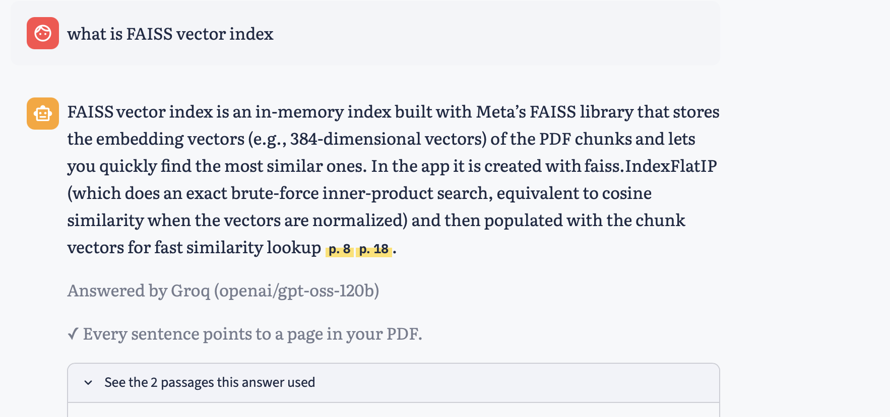

# 📄 Ask Your PDF: RAG Chatbot with Page Citations

Upload one or more PDFs, ask questions in plain English, and get short answers where every sentence shows the page it came from. If the answer is not in the PDF, the app says so instead of guessing.

**🔗 Live demo:** https://ask-your-pdf-arnav.streamlit.app



## Features

- **Page-level citations:** every sentence is tagged with its source and shown as a highlighted page mark (hover to see the file name)
- **Hybrid search:** FAISS vector search (meaning) + BM25 keyword search (exact words), merged with Reciprocal Rank Fusion
- **Citation check:** code checks every sentence of the answer, confirms each tag points to a real retrieved passage, and warns when any sentence has no page reference
- **Multi-provider LLM with failover:** Groq (open models such as gpt-oss and Llama) first, Google Gemini as backup, with retries, timeouts and a circuit breaker on both providers
- **Follow-up questions:** remembers the last two turns, so "explain that more simply" works
- **Streaming answers, suggested starter questions, chat download, auto indexing on upload**

## How it works

```
Indexing (once per upload)
PDF -> pypdf (text per page) -> chunks of ~900 chars, 150 overlap
    -> sentence-transformers embeddings (384 dims) -> FAISS index
    -> tokens -> BM25 index

Answering (every question)
question -> FAISS top 20 + BM25 top 20 -> RRF merge -> best 5 passages
         -> LLM with strict rules (sources only, tag every sentence [S1], say "not found")
         -> per-sentence citation check -> answer with page marks
```

Chunks never cross a page boundary, so every citation points to one exact page.

## Tech stack

Python, Streamlit, pypdf, sentence-transformers (all-MiniLM-L6-v2), FAISS, rank-bm25, Groq API (gpt-oss, Llama), Google Gemini API, pandas

## Engineering challenges I solved

| Problem in production | Fix |
|---|---|
| Deploy took ages: pip pulled the 2 GB GPU build of PyTorch | Pinned the CPU-only PyTorch index in requirements.txt |
| Google retired the Gemini model I used (HTTP 404) | Model name lives in one config line, so the fix was one line |
| A slow API call froze the whole UI | Per-request timeouts and loading extras after the main content |
| Gemini overloaded (HTTP 503) | Retries with back off, fallback models, then a second provider (Groq) |
| Every question waited on a failing provider | Circuit breaker on both Groq and Gemini: a failed provider moves to the back of the line for 5 minutes |
| A provider can retire models anytime | The app reads Groq's live model list and picks an available one |
| The ✓ "fully cited" badge showed even when only one sentence had a tag | Citation check now looks at every sentence, not just whether any tag exists |

## Evaluation

`eval.py` scores retrieval on a hand-written question set (`eval_questions.csv`), where each question is paired with the page that holds the answer. One run compares all three retrieval modes and prints a table ready to paste here.

```
python eval.py              # dense vs BM25 vs hybrid, hit rate @ 5 and MRR
python eval.py --with-llm   # also: share of answers where every sentence is cited
```

| Metric | Dense only | BM25 only | Hybrid |
|---|---|---|---|
| Hit rate @ 5 | 95.2% | 97.6% | **100.0%** |
| MRR | 0.781 | 0.858 | **0.882** |

Question set: 42 hand-written questions across 2 PDFs in `sample_pdfs` (NIST AI Risk Management Framework, 48 pages, and the Union Budget 2026-27 speech, 65 pages), tagged as keyword (21), paraphrase (15) or general (6). Every expected page was checked against the text pypdf extracts, and each answer appears on exactly one page. Page numbers are PDF page positions, not the printed page numbers.

Hybrid found the right page in the top 5 for all 42 questions, against 95.2% for dense search alone and 97.6% for BM25 alone, and ranked it highest on average (MRR 0.882 vs 0.781 for dense). Merging both with RRF beats either one.
Tried and rejected: joining words split by line-end hyphens in the PDF text (239 fixes in the NIST PDF). It shifted chunk boundaries and lowered hybrid hit rate from 100% to 97.6% with no real BM25 gain (MRR 0.858 to 0.862), so it was reverted.

## Run it locally

```
git clone https://github.com/arnav2293-afk/ask-your-pdf-rag.git
cd ask-your-pdf-rag
python3 -m venv venv
source venv/bin/activate          # Windows: venv\Scripts\activate
pip install -r requirements.txt
cp .streamlit/secrets.toml.example .streamlit/secrets.toml   # add your keys
streamlit run app.py
```

Free keys: Groq at https://console.groq.com and Gemini at https://aistudio.google.com. One key is enough; with both, each is the other's backup.

## Limitations and next steps

- Scanned PDFs need OCR first (the app shows a message when no text is found)
- Tables are read as plain text, so complex tables lose structure
- The BM25 tokenizer keeps only English letters and digits, so Hindi PDFs need a new tokenizer as well as multilingual embeddings
- Next: cross-encoder reranker, persistent vector database (ChromaDB), Hindi support

## Author

**Arnav Shahi**, B.Tech AIML (2nd year) [GitHub](https://github.com/arnav2293-afk) | [LinkedIn](https://www.linkedin.com/in/arnav-shahi-b7a787369)
